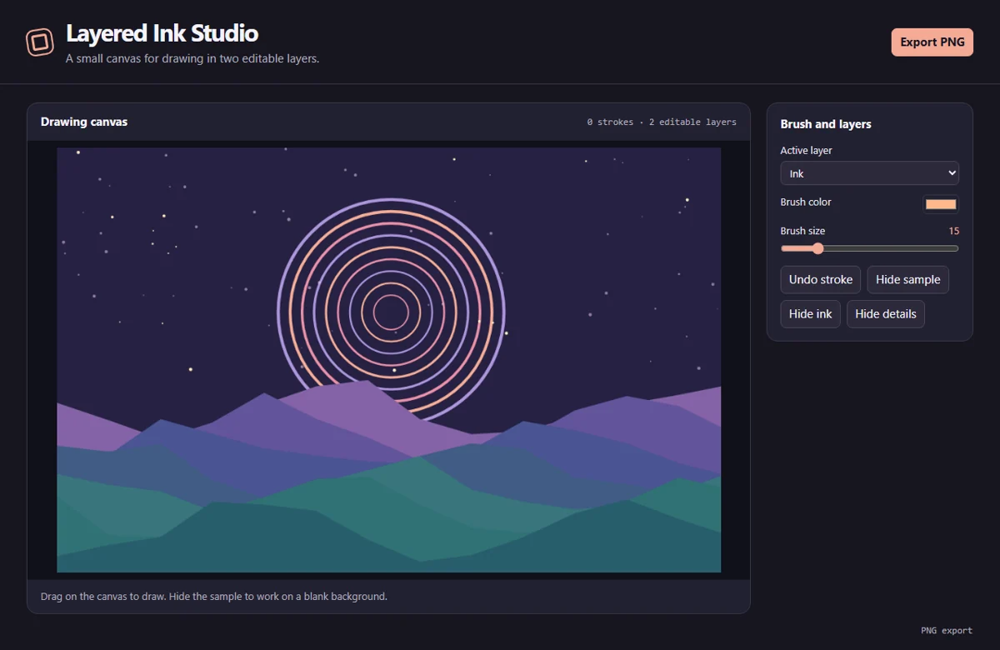

# Layered Ink Studio

Draw with two independently visible ink layers, brush controls, undo, and PNG export.



## Run locally

Install Node.js 24 and npm. From the repository directory, run:

```sh
npm ci
npm start
```

The first command installs the pinned Electron runtime. The second opens the desktop window. All artwork is processed locally. The app requires no account or API key.

## Use the app

Pick the Ink or Details layer, select a color and brush size, then drag to draw. Details render above Ink. Toggle either layer independently, undo strokes in reverse creation order, and export the visible composition at 1000 × 640.

The project lives in memory during the session. Export preserves the visible pixels.

## Project layout

- `main.cjs` creates the Electron window and handles native export dialogs.
- `preload.cjs` exposes the small set of desktop operations available to the renderer.
- `app.js` manages shared controls, canvas input, and export encoding.
- `tool.js` contains this app's drawing and editing logic.

## Verify

```sh
npm test
```

The test starts an offscreen Electron window, changes a real editor control, verifies the resulting artwork, and checks the encoded export. On a headless Linux host with Xvfb, use `xvfb-run -a npm test`.
